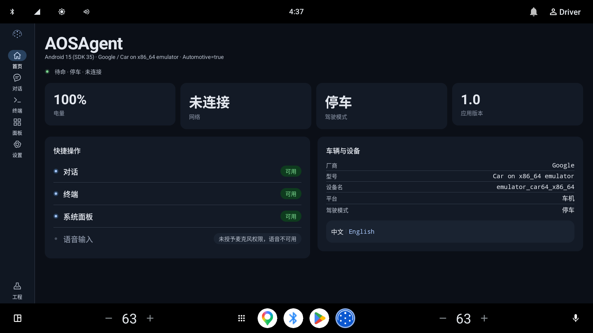

# AOS-Agent

运行在 Android Automotive OS 车机上的原生 AI Agent，提供 AI 对话、真实终端、车辆与设备状态、语音交互和工程师诊断。

[](https://github.com/Chelase/aos-agent/actions/workflows/ci.yml)
[](https://github.com/Chelase/aos-agent/releases/latest)
[](LICENSE)

[项目官网](https://chelase.github.io/aos-agent/) · [下载安装](https://github.com/Chelase/aos-agent/releases/latest) · [更新日志](CHANGELOG.md) · [反馈问题](https://github.com/Chelase/aos-agent/issues)

面向原生 AAOS 车机，不是手机端 Android Auto 投屏应用。当前处于开发与车型适配阶段：停车时使用完整触控界面，检测到驾驶受限状态时使用语音遮罩；设备缺少能力时显示具体原因。

## 界面预览



AAOS 模拟器中的开发构建，1920 × 1080。支持日间、夜间主题和中英文；截图中的设备信息与版本号来自该开发环境。

## 已有功能

| 功能 | 当前实现 |
|---|---|
| AI 对话 | 接入 OpenAI 兼容的 Chat Completions 服务，支持流式回答与工具调用；模型服务由使用者配置 |
| 工具与 Skill | 内置系统诊断和车辆状态 Skill，支持远端 MCP 工具来源；按工具权限决定可用性 |
| 真实终端 | 基于 Termux 终端仿真代码和 JNI PTY，运行 Android 系统 shell，支持输入、滚动和会话管理 |
| 车辆与系统面板 | 展示设备、网络、系统与可读取的车辆属性；动力电池通过 VHAL 尝试读取，缺失时显示原因 |
| 语音交互 | 系统语音识别、TTS、连续对话及本地 Vosk 唤醒；可用性取决于系统服务、模型与权限 |
| 快速配置 CLI | 终端内 `aos-llm` 快速配置/切换模型服务（存档案、一键 use），装车时免去触屏长输入 |
| 工程师模式 | 查看设备能力、车辆属性和驾驶态诊断，辅助车型适配与唤醒调试 |
| 开机与后台服务 | 已实现开机广播与前台服务链路，实际自启和保活效果受 OEM 系统策略影响 |
| 应用内更新 | 检查 GitHub Release 清单、下载 APK、校验 SHA-256 后交给系统安装器 |

导航切换会保留当前对话、进行中的请求、未发送输入和未保存的设置草稿；不承诺这些状态在进程被系统回收后恢复。已保存的设置由 DataStore 持久化。

## 安装与首次使用

### 运行条件

- Android 12 / API 31 及以上的 Android Automotive OS 设备。
- 提供 `arm64-v8a` 车机与 `x86_64` 模拟器构建。
- 设备需要允许安装第三方 APK；车辆 API、麦克风、语音服务和后台运行能力以系统授权为准。

### 安装

从 [Releases](https://github.com/Chelase/aos-agent/releases/latest) 下载 `aos-agent-<版本>.apk`，通过车机允许的安装方式安装。

开发设备也可使用 ADB：

```bash
adb devices
adb -s <设备序列号> install -r aos-agent-<版本>.apk
adb -s <设备序列号> shell am start -n com.aos.agent/.MainActivity
```

AAOS 模拟器可能使用前台用户 `10`；请按实际用户选择 `--user`，不要默认所有设备均为用户 `0`。升级时使用相同签名的正式发布包；本地 Debug 包与正式包的签名不同。

### 配置模型服务

打开「设置 → 模型服务」，填写并保存：

- **Base URL**：提供方的 OpenAI 兼容接口，例如 `https://your-provider.example/v1`。
- **Model**：提供方支持的模型标识。
- **API Key**：按提供方要求填写；不需要认证的自建服务可留空。

Base URL 可以填写到 `/v1`，也可以填写完整的 `/chat/completions` 地址。配置完成后到「对话」发送消息。Agent 工具调用还要求所选模型支持相应接口。

访问宿主机上的开发服务时，Android 模拟器可使用 `10.0.2.2`；车机上的 `localhost` 指向车机自身。公网服务应使用 HTTPS，当前明文 HTTP 例外仅面向回环地址与模拟器宿主地址。

### MCP 与语音

- **MCP**：在「设置 → MCP 工具来源」添加服务名称和 Streamable HTTP 地址。工具是否可执行还受权限策略约束；来源不可用时界面会显示状态。
- **语音**：先检查设备是否提供系统语音识别与 TTS，并授予麦克风权限。部分量产车机没有这些服务，本地唤醒不会自动补齐完整 ASR/TTS 能力。
- **唤醒词**：在设置中下载约 42 MB 的中文 Vosk 小模型，设置 Agent 名字和唤醒说法，再启用唤醒。模型按需下载，不随 APK 内置。

模型请求会发送到你配置的服务端，MCP 工具调用会发送到对应服务。API Key 和 MCP Token 保存在应用私有 DataStore 中；不要将真实凭据、用户对话或车辆敏感信息贴到公开 Issue。

## 车型适配与已知限制

- **读取车辆信息不代表拥有车辆控制权限**：当前内置车辆工具以只读查询为主，普通第三方应用能读到哪些属性取决于厂商实现与授权。
- **终端运行在应用权限内**：不自带 root，也不是预装完整 Linux 发行版；系统命令与可访问路径由设备决定。
- **驾驶态可能未知**：以 `CarUxRestrictions` 等系统能力实际探测结果为准，失败信息可在工程师页面查看。
- **语音服务可能缺失**：有麦克风和唤醒模型，不等于车机一定具备可用的系统识别或播报服务。
- **实车更新联网问题仍待复测**：模拟器已验证更新链路，但部分实车曾无法连接发布站点；需要在车上分别确认外网、DNS 和 GitHub 发布地址可达性。
- **安装受系统策略限制**：下载并校验完成后仍需系统安装器与用户确认，当前不提供静默更新。

模拟器验证不能替代实车适配。提交车型问题时，请附上设备型号、Android 版本、App 版本、复现步骤和脱敏后的诊断信息。

## 本地开发

### 工具链

| 工具 | 项目配置 |
|---|---|
| JDK | 17 |
| Android SDK | `platforms;android-36.1`，编译 API 36.1；目标 API 36 |
| Android Gradle Plugin | 9.2.1 |
| Kotlin | 2.3.21 |
| Gradle | 使用仓库 Wrapper，9.4.1 |
| NDK | 27.2.12479018 |
| CMake | 3.22.1 |

建议使用支持当前 AGP 的 Android Studio，并通过 SDK Manager 安装所需 SDK、NDK 和 CMake。设置 `JAVA_HOME` 为 JDK 根目录，SDK 路径通过 Android Studio、环境变量或本机 `local.properties` 配置。

### 构建与测试

```bash
git clone https://github.com/Chelase/aos-agent.git
cd aos-agent

# macOS / Linux
./gradlew :app:assembleDebug
./gradlew :app:testDebugUnitTest

# 连接 AAOS 模拟器或测试设备后运行 UI 测试
./gradlew :app:connectedDebugAndroidTest
```

Windows PowerShell 使用 `./gradlew.bat` 执行相同任务。

Debug APK 位于 `app/build/outputs/apk/debug/app-debug.apk`。当前发布前验证包含 223 个单元测试和 AAOS 模拟器界面走查；车型实测另行记录。

### 正式发布

正式版本由 `vX.Y.Z` 标签触发 [Release 工作流](.github/workflows/release.yml)：构建签名 APK、验证签名、生成 `update.json` 并上传 GitHub Release。

版本名来自标签，版本代码使用 `major × 10000 + minor × 100 + patch`。本地构建未传版本参数时使用开发默认值 `1.0` / `1`。

本地构建正式包需提供签名配置，缺失时构建会直接失败：

```bash
./gradlew :app:assembleRelease -PVERSION_NAME=1.1.0 -PVERSION_CODE=10100
```

签名材料通过本机 `keystore.properties` 或 `AOS_SIGNING_*` 环境变量配置，字段见 [构建脚本](app/build.gradle.kts)。私钥、口令、本机 SDK 路径和调试日志不应提交到仓库。

## 代码与文档

```text
app/src/main/
├── java/com/aos/agent/
│   ├── ui/          # 页面、主题和共享控件
│   ├── runtime/     # Agent、工具、Skill 与配置的装配
│   ├── core/        # 推理、模型接口、工具、MCP、Skill 和更新逻辑
│   ├── terminal/    # 终端仿真、会话和 JNI 接口
│   ├── system/      # 系统、车辆、语音与安装器适配
│   ├── data/        # DataStore 配置
│   ├── receiver/    # 开机广播
│   └── service/     # 前台服务
├── cpp/             # PTY 原生桥接
└── assets/          # 内置 Skill 与车辆属性白名单
```

- [UI 机制](.agent-rules/mechanisms/ui-design-system.md)：页面装配、状态、主题和语言。
- [终端机制](.agent-rules/mechanisms/terminal-architecture.md)：终端会话与 PTY。
- [语音交互](.agent-rules/mechanisms/voice-interaction.md)与[本地唤醒](.agent-rules/mechanisms/wake-word-kws.md)。
- [发布与更新](.agent-rules/mechanisms/release-and-update.md)：签名、更新清单与安装门控。
- [图标母版与来源](artwork/README.md)。
- [官网开发与部署](site/README.md)：独立静态页面、资源来源和 Pages 工作流。
- [Agent 协作入口](AGENTS.md)：参与代码修改前读取项目规则。

欢迎通过 Issue 提交问题和改进建议，通过 Pull Request 参与开发。请先区分真实设备能力缺失、网络配置问题与应用缺陷，并提供可复现的信息。

## 许可证与第三方组件

Copyright 2026 Chelase.

本项目中有权授权的原创代码与文档采用 [Apache License 2.0](LICENSE)。该协议允许商业使用、修改和闭源集成，不要求衍生项目公开源码；再分发时需遵守保留许可证、相关声明和标明修改等条件。专利授权与商标使用边界以许可证正文为准。

第三方代码、依赖、模型和参考资料保留各自的版权及许可证，不因本项目采用 Apache-2.0 而被统一重新授权。来源与声明见 [NOTICE](NOTICE) 和 [第三方许可说明](licenses/README.md)。
