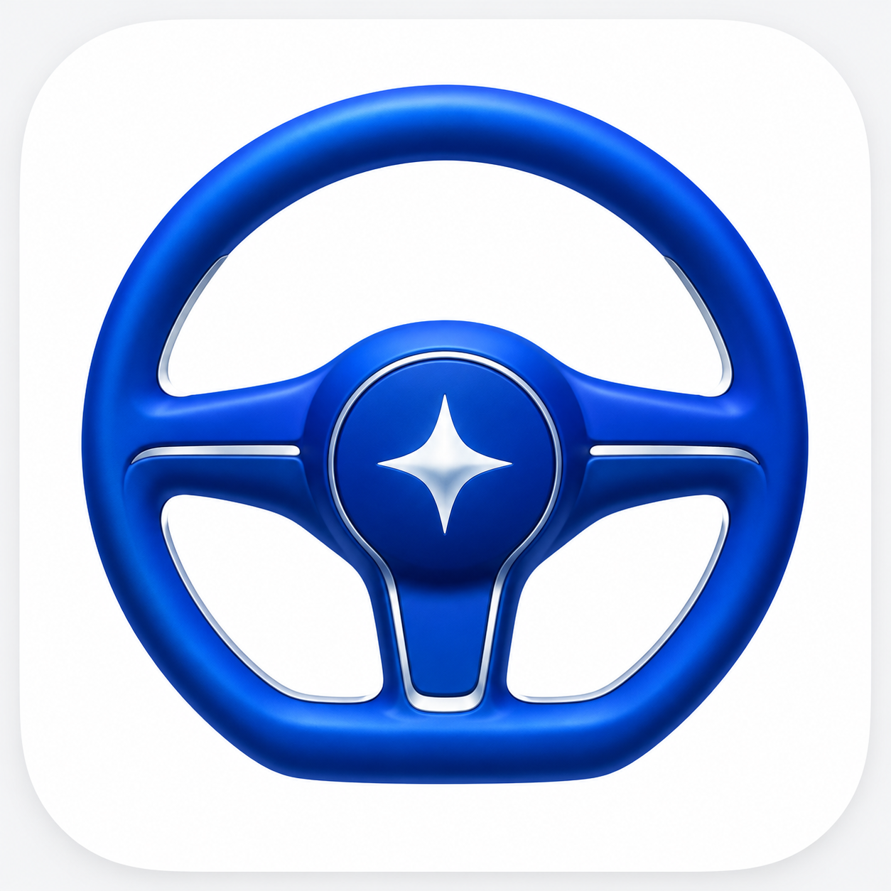

# 蓝白车机 Agent 图标候选

2026-10-18：用户选定第一版环形灯组的蓝底白色造型，随后要求白色图案稍微放大、加粗，`07` 已同步到项目图标资源。`01`—`04` 是内置 imagegen 生成的未采用概念稿，原图在 Codex generated_images 中保留。2026-10-19 已重新构建 Debug APK、通过 223 个单元测试，并安装至可见 AAOS 模拟器。

## 07 蓝底白色放大加粗版（已接入）


[可编辑 SVG](07-original-ring-white-on-blue-bold.svg)。保持布局与蓝白配色，整体放大 7.5%，弧线基础宽度由 1.8 增至 2.16，顶灯半径由 3.8 增至 4.1，其余灯点半径由 3 增至 3.25。

## 06 第一版环形灯组蓝底白色基础版


[可编辑 SVG](06-original-ring-white-on-blue.svg)。背景为 `#0B57D0`，全部灯点与弧线为 `#FFFFFF`，保留第一版全部几何。

## 05 第一版环形灯组白底蓝色存档


[可编辑 SVG](05-original-ring-blue-white.svg)。直接修改原生矢量颜色，保留首版全部路径、圆点尺寸和 1.8dp 弧线。

## 00 第一版环形灯组深色存档


[原始几何 SVG](00-original-ring-dark.svg)。按首版矢量路径与配色留存，供后续核对造型。

## 04 机械仪表线性候选


以 `01-mechanical-gauge.png` 为编辑参考，保留开口表盘、刻度、指向右上方的机械指针和中心轴，改为蓝色线条与白色底面。

完整编辑提示词：

```text
Edit the attached selected mechanical automotive gauge app-icon concept into a refined LINE / OUTLINE ICON. Preserve the automotive instrument identity, a 240–270 degree circular gauge arc with an open lower section, sparse precise radial ticks, exactly one mechanical needle pointing toward upper-right around 1:30–2 o'clock, and a small circular central pivot. Fundamentally change the rendering to pure flat monoline blue vector-style linework on pure white. One cobalt blue #0B57D0 only. The dial interior must be entirely white, no solid blue dial or colored disc. Draw a single clean open outer arc with substantial consistent stroke weight and rounded line caps, balanced radial tick marks with only a few longer major ticks. Draw the tapered needle as an elegant narrow outlined pointer, white interior, blue outline, ending at the small blue outlined circular pivot; make the pointer unmistakable. Keep negative space generous and geometry precise. The silhouette should read as a speedometer / tachometer, not a clock, compass or chat app. Absolutely no 3D, metallic finish, bevel, emboss, texture, gradient, glow, cast shadow, drop shadow, background halo, numbers, text, labels, extra symbols, car silhouette, chip, AI sparkle or watermark. One large centered icon on a perfectly white square canvas, with an imaginary rounded-square launcher safe area, no visible tile outline. Keep the entire gauge mark within the center 70% of the canvas with balanced margins. Clean contemporary automotive cockpit instrument line icon, readable at 48px. Output one finished icon only.
```

## 01 机械仪表指针


完整生成提示词：

```text
Create exactly ONE finished app icon concept for AOS-Agent, an intelligent agent running on Android Automotive OS. Blue and white palette only: rich automotive cobalt blue, clean white, very subtle cool silver where needed. Premium automotive instrument / cockpit identity. Confident, carefully proportioned, beautifully crafted, legible at small sizes. Square canvas, front-on centered composition, single white rounded-square app tile filling almost the entire canvas with narrow neutral outer margin. Large centered emblem occupying about 66 percent of the tile. No words, letters, labels, badges, captions, presentation board, watermark or extraneous objects. No chat bubble, messenger symbol, robot face, car-front-with-chip graphic, microchip pins or medical cross. Avoid toy-like illustration, busy ornament, neon glow or gratuitous gradients. The result should feel like a considered automotive brand icon, not a generic stock UI glyph. DIRECTION 1 — MECHANICAL INSTRUMENT NEEDLE. A beautiful mechanical automotive speedometer/tachometer is the entire emblem. A substantial deep-blue circular dial with a clear lower break / horseshoe opening; crisp white precision graduations along a 240-degree arc. One unmistakable tapered physical white/silver pointer rising from a finely machined circular hub and pointing toward the upper-right, like a real dashboard needle. Give the needle a restrained beveled edge and one believable subtle shadow against the blue dial to express mechanical precision, not a flat line. Broad elegant forms; only a handful of major ticks and sparse small ticks. No numbers or text. Symmetric housing, visually balanced needle, restrained dimensional depth. Beautiful blue and white physical instrument condensed into a memorable app icon.
```

## 02 智能方向盘



完整生成提示词：

```text
Create exactly ONE finished app icon concept for AOS-Agent, an intelligent agent running on Android Automotive OS. Blue and white palette only: rich automotive cobalt blue, clean white, very subtle cool silver where needed. Premium automotive instrument / cockpit identity. Confident, carefully proportioned, beautifully crafted, legible at small sizes. Square canvas, front-on centered composition, single white rounded-square app tile filling almost the entire canvas with narrow neutral outer margin. Large centered emblem occupying about 66 percent of the tile. No words, letters, labels, badges, captions, presentation board, watermark or extraneous objects. No chat bubble, messenger symbol, robot face, car-front-with-chip graphic, microchip pins or medical cross. Avoid toy-like illustration, busy ornament, neon glow or gratuitous gradients. The result should feel like a considered automotive brand icon, not a generic stock UI glyph. DIRECTION 2 — INTELLIGENT STEERING. Design a distinctive sculpted cobalt-blue automotive steering-wheel emblem. A broad near-circular steering rim with a purposeful flat lower section, two elegant horizontal spokes and one short lower spoke, all as one coherent solid form. A small refined white luminous core / four-point directional spark sits within the blue central hub, integrated into the shape, to suggest an intelligent cockpit agent. No floating sparkles. Use subtle physical edge treatment and a restrained contact shadow to create the quality of a precision molded automotive control; mostly clean flat blue planes. Strong iconic silhouette and generous white negative space. It must immediately read as a premium steering / cockpit control, not a gear, life ring, or generic AI star.
```

## 03 自主导航道路


完整生成提示词：

```text
Create exactly ONE finished app icon concept for AOS-Agent, an intelligent agent running on Android Automotive OS. Blue and white palette only: rich automotive cobalt blue, clean white, very subtle cool silver where needed. Premium automotive instrument / cockpit identity. Confident, carefully proportioned, beautifully crafted, legible at small sizes. Square canvas, front-on centered composition, single white rounded-square app tile filling almost the entire canvas with narrow neutral outer margin. Large centered emblem occupying about 66 percent of the tile. No words, letters, labels, badges, captions, presentation board, watermark or extraneous objects. No chat bubble, messenger symbol, robot face, car-front-with-chip graphic, microchip pins or medical cross. Avoid toy-like illustration, busy ornament, neon glow or gratuitous gradients. The result should feel like a considered automotive brand icon, not a generic stock UI glyph. DIRECTION 3 — AUTONOMOUS PATH. An original abstract automotive-agent brand mark made of two bold cobalt-blue flowing road ribbons. They rise from separated broad lower ends and converge into one decisive forward/upward directional tip. Their carefully cut white central negative space reads as a road guiding into the distance and subtly suggests an abstract A, without drawing typography. The ribbons create a confident compact geometric emblem with an engineered asymmetric forward gesture, not an airplane, paper plane, generic map pin or chat symbol. Use sculpted smooth blue planes and extremely restrained edge depth, generous white negative space, no decorative circuitry. Elegant, distinctive and scalable, like an identity for an intelligent driving companion. No extra symbols beyond the unified road emblem.
```
